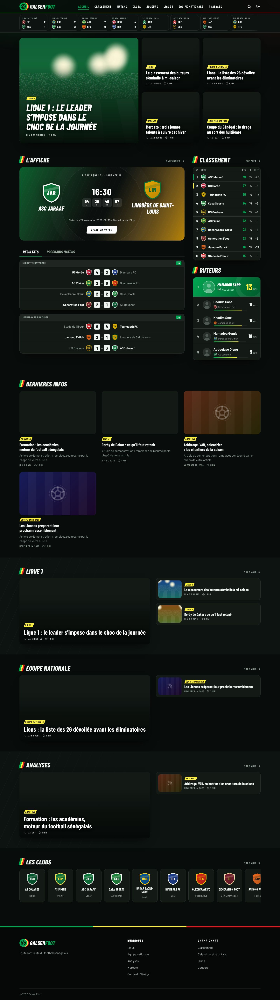
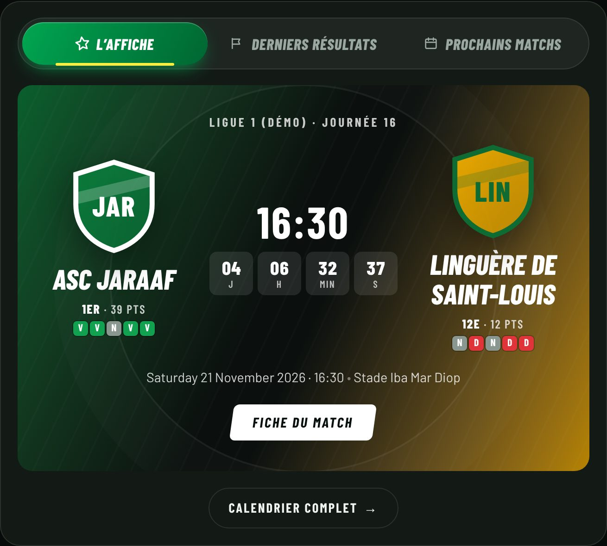

# GalsenFoot — thème WordPress + extension championnat

Thème média football pour **galsenfoot.sn**, compatible **Elementor**, optimisé **SEO**, avec gestion **Google AdSense / Google Ads**, et une extension compagnon **GalsenFoot League** qui gère le championnat, les clubs, les joueurs et leurs performances (saisie manuelle **ou** synchronisation automatique via **API-Football**).

| Dossier | Contenu |
|---|---|
| `galsenfoot/` | Le thème (à zipper et installer dans *Apparence → Thèmes*) |
| `galsenfoot-league/` | L'extension (à zipper et installer dans *Extensions*) |
| `docs/` | Captures d'écran (données de démonstration) |
| `build.sh` | Génère `dist/galsenfoot-theme.zip` et `dist/galsenfoot-league.zip` |



## Installation

```bash
./build.sh
```

1. *Extensions → Ajouter → Téléverser* : `dist/galsenfoot-league.zip`, puis activer. Installer aussi **Elementor** (gratuit).
2. *Apparence → Thèmes → Ajouter → Téléverser* : `dist/galsenfoot-theme.zip`, puis activer.
3. *Apparence → Démarrage GalsenFoot* : créer en un clic les pages Classement / Calendrier, le menu principal et (option) une page d'accueil Elementor déjà composée.
4. *GalsenFoot → Tableau de bord* : « Installer la démo » pour voir le site rempli (championnat fictif de 14 clubs, 182 matchs, joueurs, articles). « Supprimer la démo » efface tout.

Pré-requis : WordPress 6.0+, PHP 7.4+.

## Le thème

**Design** — ambiance « stade de nuit » (mode sombre par défaut, mode clair en un clic, mémorisé), couleurs du drapeau sénégalais en accents, typographie condensée sportive (Barlow, auto-hébergée, aucun appel à Google Fonts). Couleurs modifiables dans le Customizer.

**Effets** — apparition des blocs au défilement, survols animés (zoom + reflet sur les images, soulignement des titres), parallaxe sur la une, barre de progression de lecture, en-tête qui se rétracte au défilement, compte à rebours avant le match, chiffres qui s'incrémentent, bandeau des scores défilant. Tout est désactivable et respecte « réduire les animations » du système.

**UX** — bandeau scores sous le menu, menu mobile en tiroir, recherche plein écran, onglets Résultats / Prochains matchs, partage WhatsApp / Facebook / X / Telegram / copier le lien, fil d'Ariane, temps de lecture, bouton retour en haut, 404 thématique. Accessible (lien d'évitement, focus visibles, navigation clavier, ARIA).

**Elementor** — widgets dans la catégorie « GalsenFoot » : À la une (mosaïque), Articles (grille/liste), Emplacement publicitaire, + les 8 widgets de l'extension (Centre des matchs, Classement, Matchs, Bandeau des scores, Prochain match, Buteurs/passeurs, Clubs, Effectif). Compatible avec le Theme Builder d'Elementor Pro (en-tête, pied de page, single, archive). Sans Elementor, le thème compose lui-même une page d'accueil complète.

**SEO** — balises meta description, Open Graph, Twitter Cards ; JSON-LD `Organization`, `WebSite` (+ recherche), `NewsArticle`, `BreadcrumbList` ; et via l'extension `SportsEvent` (matchs), `SportsTeam` (clubs), `Person` (joueurs). Un seul `<h1>` par page, `max-image-preview:large` (Google Discover), recherches et 404 en `noindex`, URL propres (`/clubs/…`, `/joueurs/…`, `/matchs/…`). Si Yoast, Rank Math, SEOPress, AIOSEO ou The SEO Framework est actif, le thème leur laisse la main automatiquement.

**Performance** — CSS/JS légers sans jQuery ni framework, polices préchargées, images lazy-load sauf l'image principale (`fetchpriority=high`), emplacements publicitaires à hauteur réservée (pas de décalage de mise en page / CLS).

## Publicités et Google (*Apparence → Publicités & Google*)

- **AdSense** : identifiant éditeur → chargement du script, validation du site, annonces automatiques (à activer dans AdSense).
- **9 emplacements** : sous l'en-tête, accueil (×2), dans les listes, article (avant / dans le texte / après), colonne latérale, pied de page. Pour chacun : ID de bloc AdSense **ou** code personnalisé (Google Ad Manager, sponsor direct…). Shortcode `[gf_ad slot="…"]` et widget Elementor.
- **Insertion automatique dans les articles** : après le paragraphe N, puis tous les X paragraphes, avec un maximum, sans jamais couper une citation, une liste ou un tableau.
- **ads.txt** généré automatiquement (+ lignes d'autres régies).
- **Google Ads** (ID `AW-…` : conversions, remarketing) et **Google Analytics 4** (`G-…`).
- **Consentement** : bandeau + Consent Mode v2 de Google (lien « Gérer les cookies » en pied de page).
- Option pour masquer les pubs aux rédacteurs connectés, case « pas de publicité » par article/page.

> Pour la publicité personnalisée auprès des visiteurs de l'Union européenne, Google exige une plateforme de consentement certifiée : utilisez alors le message de consentement intégré à AdSense (*Confidentialité et messages*).

## L'extension GalsenFoot League

- **Compétitions et saisons**, **clubs** (logo ou écusson généré aux couleurs du club, stade, ville, entraîneur…), **joueurs** (poste, numéro, naissance, taille, pied fort…), **matchs** (score, statut — à venir / en direct / terminé / reporté —, minute, journée, stade).
- **Feuille de match** : buts (normal, penalty, contre son camp), passeurs, cartons, compositions.
- **Calculé automatiquement** : classement (points, différence, forme sur 5 matchs, zones CAF/relégation, barème réglable, pénalités de points possibles), buteurs, passeurs, cartons, matchs joués, ratio, stats par joueur et par club.
- **Centre des matchs** (widget Elementor « Centre des matchs (onglets) » ou shortcode `[gsf_match_center]`) : trois onglets *L'affiche* (match vedette avec compte à rebours, rang et forme des deux équipes), *Derniers résultats* et *Prochains matchs*. Indicateur animé, navigation au clavier, point rouge sur l'onglet quand un match est en direct. Sur mobile : libellés courts, affiche en pleine largeur, abréviations des clubs et changement d'onglet en glissant le doigt. Options : club (pour une page de club), onglet ouvert par défaut, nombre de matchs, libellés personnalisés, lien vers le calendrier. Exemple : `[gsf_match_center default="results" results="8" link="/calendrier/"]`.

  

- **Pages automatiques** pour chaque club, joueur et match (fonctionnent avec n'importe quel thème).
- **Scores en direct** : les pages se mettent à jour toutes les 45 s sans recharger.
- **API REST publique** : `/wp-json/gsf/v1/standings`, `/matches`, `/leaders`.
- **Shortcodes** : `[gsf_match_center]`, `[gsf_standings]`, `[gsf_matches type="fixtures|results|live|all"]`, `[gsf_ticker]`, `[gsf_next_match]`, `[gsf_scorers stat="goals|assists|yellow|red|apps"]`, `[gsf_clubs]`, `[gsf_squad club="ID"]`.

### Synchronisation API-Football (optionnel)

1. Créer une clé sur <https://www.api-football.com/> (offre gratuite : 100 requêtes/jour ; vérifier que la saison voulue du championnat sénégalais est couverte par l'offre choisie).
2. *GalsenFoot → Tableau de bord* : coller la clé, « Rechercher les compétitions » (pays : `Senegal`) pour obtenir l'ID, saisir l'année de début de saison.
3. Lancer dans l'ordre : Clubs → Matchs et scores → Effectifs → Statistiques des joueurs. Les gros imports continuent en arrière-plan.
4. Choisir une fréquence de mise à jour automatique des scores (manuelle → toutes les 15 min).

Les éléments importés gardent leur identifiant distant : les synchronisations suivantes mettent à jour sans créer de doublons, et vos modifications manuelles (biographie, couleurs, photos…) sont conservées. On peut mélanger saisie manuelle et import.

## Ce qui a été testé

Sur WordPress 7.1 + Elementor (dernière version) + PHP 8.3, avec `WP_DEBUG` actif, aucun avertissement PHP ni erreur JavaScript :
toutes les pages (accueil classique et Elementor, article, club, joueur, match, archives, catégorie, recherche, 404, flux, API REST), modes sombre et clair ;
un audit responsive automatisé de 14 pages × 9 largeurs (320, 360, 414, 600, 768, 900, 1024, 1280, 1920 px) : aucun débordement horizontal, toutes les zones cliquables ≥ 24 px (critère WCAG 2.2 AA) et ≈ 44 px sur écran tactile pour les boutons principaux ; l'administration (réglages, feuille de match, page Publicités, assistant de démarrage) pilotée dans un navigateur ; l'import API sur des réponses simulées au format API-Football v3 (clé invalide, pagination, transferts, doublons) ; le thème sans l'extension et l'extension sans Elementor.

Non testé : appels réels à api-football.com et diffusion réelle d'annonces AdSense (pas d'accès réseau depuis l'environnement de développement).
